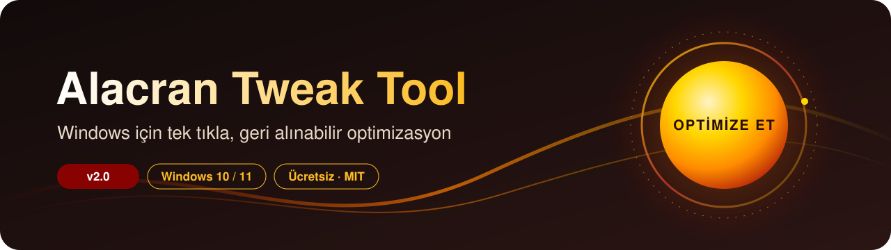
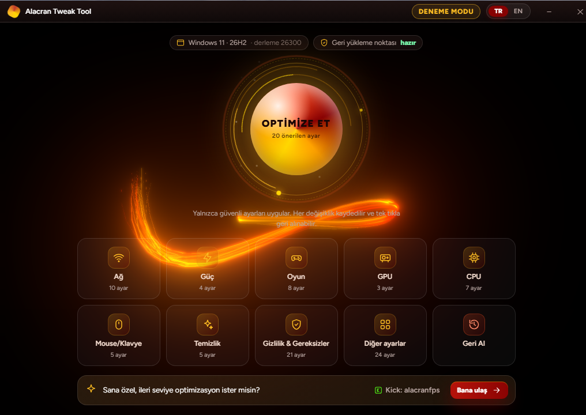

<div align="center">



<br>

[](https://github.com/alacran-8/alacran-tweaking-tool/releases/latest)
[](https://github.com/alacran-8/alacran-tweaking-tool/releases)
[](LICENSE)

**Türkçe** · [English](#-english)

</div>

<br>

Oyun ve sistem ayarlarını tek bir pencereden, **ne yaptığını görerek** ve **istediğin an geri alarak** değiştir.<br>
Kurulum yok, internet yok, gizli işlem yok — sadece tek bir `AlacranTweak.exe`.

<div align="center">

</div>

<br>

## ✨ Neler var?

<table>
<tr>
<td width="50%" valign="top">

### ⚡ Tek tıkla optimizasyon
**OPTİMİZE ET** düğmesi yalnızca güvenli ayarları uygular. Neyin değişeceğini uygulamadan önce listeler.

</td>
<td width="50%" valign="top">

### ↩️ Her şey geri alınabilir
Her değişiklikten önce eski değer yedeklenir. **Geri Al** sayfasından tek tek ya da hepsi birden.

</td>
</tr>
<tr>
<td valign="top">

### 🧭 Ne yaptığını bilerek
Her ayarın altında sade bir açıklama var: ne işe yarar, ne zaman fark etmez. Abartı yok.

</td>
<td valign="top">

### 🛡️ Riskliler ayrı
Güvenliği etkileyen ayarlar **DİKKAT** etiketli, varsayılan kapalı ve açmadan önce onay ister.

</td>
</tr>
<tr>
<td valign="top">

### 🎮 Kategoriler
Ağ · Güç · Oyun · GPU · CPU · Mouse/Klavye · Temizlik · Gizlilik · Diğer — 87 ayar.

</td>
<td valign="top">

### 🧰 Araçlar
SFC, DISM, DNS temizleme, Winsock sıfırlama gibi onarım araçları tek tıkla, görünür pencerede.

</td>
</tr>
</table>

## 🚀 Nasıl kullanılır?

1. **[Releases](https://github.com/alacran-8/alacran-tweaking-tool/releases/latest)** sayfasından `AlacranTweak.exe`'yi indir.
2. Çift tıkla ve yönetici iznini onayla.
3. **OPTİMİZE ET**'e bas ya da kategorilere girip istediğin ayarları seç.
4. Bitince bilgisayarı yeniden başlat.

> [!TIP]
> Önce denemek mi istiyorsun? `AlacranTweak.exe --dry-run` ile aç: her şeyi gösterir ama **hiçbir şeyi değiştirmez**.

## 🔒 Güvende misin?

| Koruma | Ne yapar? |
|---|---|
| 🧷 **Geri yükleme noktası** | İlk uygulamadan önce Windows geri yükleme noktası oluşturulur. |
| 💾 **Yedek** | Eski değerler `C:\ProgramData\AlacranTweak\backups` klasöründe saklanır. |
| 🌐 **İnternet** | Uygulama internete bağlanmaz, bir şey indirmez veya çalıştırmaz. |
| 🧾 **Şeffaflık** | Kaynak kodu bu depoda. Yapılan her işlem `apply.log` dosyasına yazılır. |

> [!NOTE]
> Dosya henüz dijital olarak imzalı değil. Windows SmartScreen uyarı verirse **Ek bilgi → Yine de çalıştır**.
> İndirdiğin dosyayı doğrulamak için SHA-256 değeri her sürüm notunda yazıyor:
> ```powershell
> Get-FileHash .\AlacranTweak.exe -Algorithm SHA256
> ```

## 💻 Gereksinimler

- Windows 10 (21H2 ve üstü) veya Windows 11, 64 bit
- Yönetici izni
- Microsoft WebView2 — Windows 11'de hazır gelir, yoksa uygulama indirme sayfasını açmayı önerir
- Sistem sürücüsünde **Sistem Koruması** açık (geri yükleme noktası için)

## 💬 Sana özel optimizasyon

Uygulama tamamen ücretsiz. Bilgisayarına özel, birebir ileri seviye optimizasyon istersen:

<p>
<a href="https://www.alacrantweak.com"></a>
<a href="https://www.youtube.com/@alacrann"></a>
<a href="https://kick.com/alacranfps"></a>

</p>

<details>
<summary><b>📜 Eski sürüm (1.1, .bat)</b></summary>
<br>

Eski Batch sürümü [`legacy/`](legacy) klasöründe ve [Releases](https://github.com/alacran-8/alacran-tweaking-tool/releases) sayfasında duruyor.
Hataları düzeltilmiş kopyası ve düzeltme notları: [`legacy/fixed/`](legacy/fixed).
Yeni sürüme hangi ayarların neden alınmadığı: [`docs/dropped-tweaks.md`](docs/dropped-tweaks.md).

</details>

<details>
<summary><b>🛠️ Kaynaktan derleme</b></summary>
<br>

Rust, Node.js ve Visual Studio 2022 Build Tools gerekir.

```bat
cd alacran-tweak-app
npm install
scripts\test.cmd
npx vitest run
scripts\build.cmd
```

Çıktı: `C:\at-target\release\AlacranTweak.exe`. Uygulama ve geri alma testleri sanal makinede yapılır: [`docs/vm-testing.md`](docs/vm-testing.md).

</details>

<br>

---

## 🌍 English

<details>
<summary><b>Read in English</b></summary>
<br>

A free, single-file tweak app for Windows 10 (21H2+) and Windows 11. Every change shows what it does and can be undone at any time.

- **One-click optimise** — the big button applies safe tweaks only, and lists them first.
- **Everything is revertible** — old values are backed up; restore one by one or all at once.
- **Honest texts** — each tweak says what it does and when it makes no difference.
- **Risky tweaks are separate** — marked **CAUTION**, off by default, confirmation required.
- **No installer, no network access**, a system restore point before the first apply.

**Use:** download `AlacranTweak.exe` from [Releases](https://github.com/alacran-8/alacran-tweaking-tool/releases/latest), run it, accept the admin prompt. `--dry-run` shows everything and changes nothing.

**Requirements:** Windows 10 21H2+ / 11 x64, admin rights, WebView2 Runtime, System Protection on for the system drive. The file is not code-signed yet; check the SHA-256 in the release notes.

</details>

---

<div align="center">
<sub>MIT Lisansı · <a href="LICENSE">LICENSE</a> · Tauri (MIT / Apache-2.0), threejs-components (ISC), three.js r180 (MIT)</sub>
</div>
